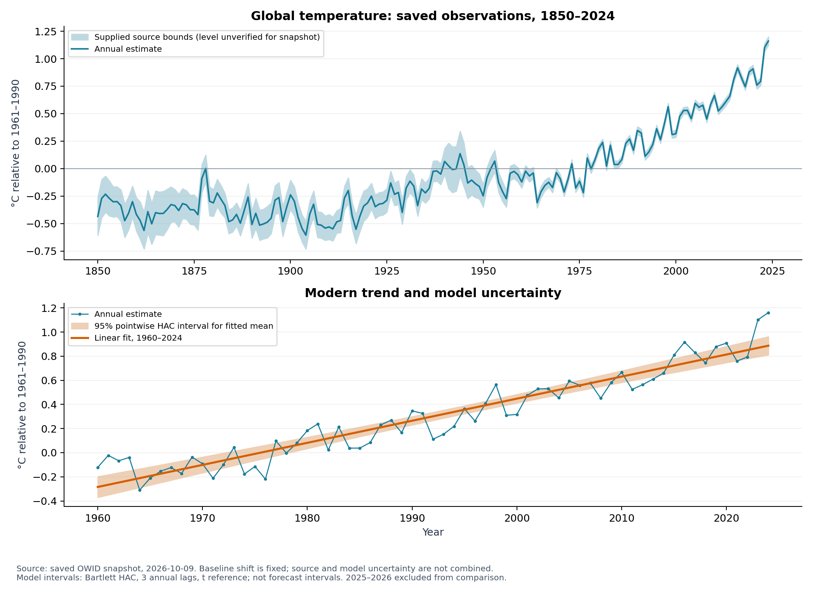
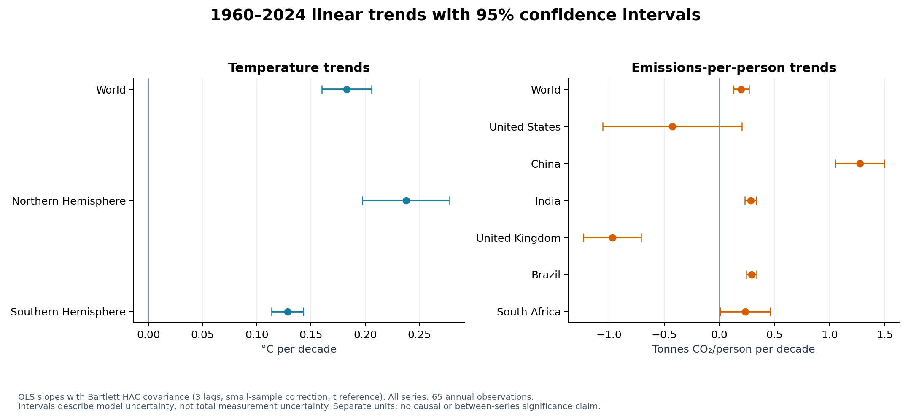
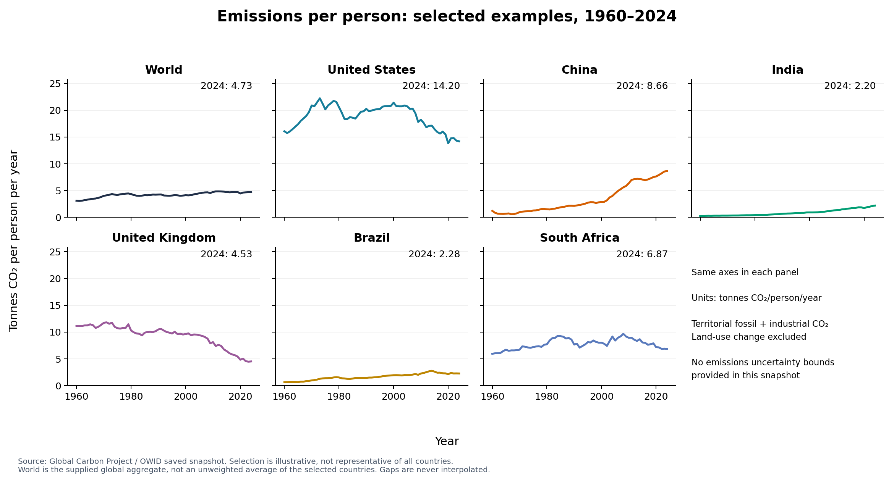
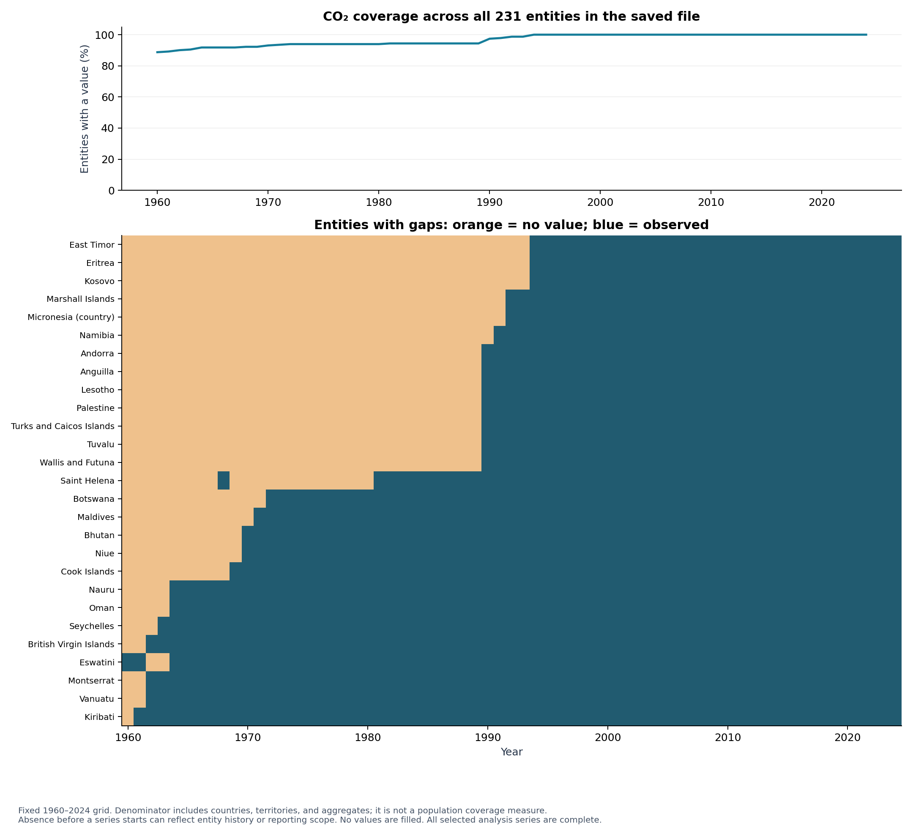

# ClimateLens: first statistical analysis

## Questions and scope

How did global and hemispheric temperature change during 1960–2024, and how did CO₂ emissions per person evolve in six illustrative countries and the supplied World aggregate?

This is a descriptive analysis of the saved snapshot retrieved on **2026-10-09T08:02:39.540580+00:00**, not a forecast, causal attribution study, country ranking, or estimate of individual emissions. The temperature data has three geographic aggregates, not country-level observations. Countries were selected explicitly as geographic and emissions-history examples (United States, China, India, United Kingdom, Brazil, South Africa), not by a significance screen or random sampling.

The primary comparison uses **1960–2024: 65 annual observations per selected series**. Temperature history is also shown for 1850–2024. The six temperature rows for 2025–2026 are excluded from the comparison: CO₂ ends in 2024, and 2026 is an incomplete calendar year at the snapshot date. No current-year annualization is attempted. The input CSV central values were checked against the existing SQLite database before the frozen analysis snapshot was created.

## First findings

- Global temperature increased at an estimated **0.183 °C per decade**, with a **95% HAC interval of [0.160, 0.206]**, over 1960–2024.
- The 2024 global temperature estimate is **1.161 °C above this saved series' 1961–1990 mean**. This is an explicitly recomputed baseline, not an assertion about the original CSV's baseline.
- World CO₂ emissions per person changed from **3.11** to **4.73 tonnes/person/year** between 1960 and 2024. The individual examples have different trajectories; the global aggregate is supplied by the source and is never computed as a mean of selected countries.
- The selected series contain no missing annual values in the analysis period. The broader CO₂ file has **499 missing entity-years out of 15,015** in the fixed 1960–2024 grid; **27 of 231 entities** have at least one gap. These include countries, territories, and aggregates, not a sample of interchangeable countries.

## Charts

The upper panel shows saved source bounds shifted by the same fixed baseline as the central estimates. Their nominal confidence level cannot be authenticated from the saved CSV alone. The lower panel shows a distinct, calculated 95% pointwise interval for the fitted linear mean. It is neither a future-observation prediction interval nor a combined source/model uncertainty interval.

Each point is a separate regression; bars are 95% model intervals. Overlap or non-overlap is not used as a formal test of differences between regions. The two panels use different units.

These source figures describe territorial fossil-fuel and industrial emissions per person, excluding land-use change. The country charts share axes. No measurement-error bounds were supplied for emissions, so none are invented. The source definition is documented in [OWID's CO₂ data page](https://ourworldindata.org/grapher/co-emissions-per-capita).

The coverage denominator is every distinct entity in the saved CO₂ file, held fixed over time. It includes aggregates and does not measure population coverage. Leading gaps may reflect entity history or changes in reporting scope, rather than failed measurement.

## Numerical results

Temperature slopes are °C/decade; CO₂ slopes are tonnes/person/year per decade. Interannual standard deviations and other descriptive statistics are in `descriptive_statistics.csv`; these describe variability, not precision of the mean.

| Dataset | Entity | Slope per decade | 95% HAC interval | n |
|---|---|---:|---:|---:|
| co2_per_capita | Brazil | 0.291 | [0.245, 0.336] | 65 |
| co2_per_capita | China | 1.273 | [1.049, 1.497] | 65 |
| co2_per_capita | India | 0.283 | [0.232, 0.335] | 65 |
| co2_per_capita | South Africa | 0.236 | [0.010, 0.461] | 65 |
| co2_per_capita | United Kingdom | -0.971 | [-1.234, -0.708] | 65 |
| co2_per_capita | United States | -0.426 | [-1.056, 0.204] | 65 |
| co2_per_capita | World | 0.197 | [0.127, 0.268] | 65 |
| temperature_anomaly | Northern Hemisphere | 0.238 | [0.197, 0.278] | 65 |
| temperature_anomaly | Southern Hemisphere | 0.128 | [0.114, 0.143] | 65 |
| temperature_anomaly | World | 0.183 | [0.160, 0.206] | 65 |

Endpoint changes below are descriptive, not a fitted trend or causal effect. Percentage changes use the exact 1960 and 2024 endpoints; they are undefined if the first value is zero.

| Entity | 1960 tonnes/person | 2024 tonnes/person | Endpoint change |
|---|---:|---:|---:|
| Brazil | 0.65 | 2.28 | +252.0% |
| China | 1.22 | 8.66 | +609.7% |
| India | 0.26 | 2.20 | +762.0% |
| South Africa | 5.95 | 6.87 | +15.5% |
| United Kingdom | 11.11 | 4.53 | -59.3% |
| United States | 16.07 | 14.20 | -11.7% |
| World | 3.11 | 4.73 | +51.9% |

## Uncertainty and sensitivity

For each series, regress its annual value on an intercept and centered calendar time measured in decades. The slope is therefore directly in units per decade. Calculate heteroskedasticity- and autocorrelation-consistent (HAC) covariance using a Bartlett kernel, **three annual lags**, a small-sample correction, and a t reference distribution with n−2 degrees of freedom. [statsmodels documents these covariance options](https://www.statsmodels.org/stable/generated/statsmodels.regression.linear_model.OLSResults.get_robustcov_results.html).

This permits short-range serial dependence in regression residuals; it does not guarantee that a single linear trend fits the entire climate process. It assumes enough observations, a useful linear mean model, and sufficiently weak residual dependence for asymptotic HAC inference to be informative. The intervals do not include uncertainty in source construction, the baseline mean, systematic bias, model selection, future emissions, or forecasts. They are marginal exploratory intervals, without a multiple-comparison adjustment. Global and hemispheric series are dependent and are not pooled as independent replicates.

The lag choice was specified before examining trend significance. For the global 1960–2024 trend, changing the HAC lag gives:

| Annual lags | Lower 95% bound (°C/decade) | Upper 95% bound |
|---:|---:|---:|
| 1 | 0.162 | 0.204 |
| 3 | 0.160 | 0.206 |
| 5 | 0.159 | 0.207 |
| 10 | 0.158 | 0.208 |

The slope does not change when only its covariance estimator changes. Starting in 1990 instead gives **0.226 °C/decade**, with interval **[0.188, 0.264]** at lag 3. This is sensitivity to the chosen period, not a formal acceleration test. `sensitivity.csv` gives both 1960 and 1990 starts and lags 1, 3, 5, and 10 for every selected series. `trends.csv` also records residual lag-one correlations and R² as diagnostics; a high R² is not evidence of causality.

**Model limitation visible in these results:** the selected emissions regressions have residual lag-one correlations from **0.87 to 0.98**. Their curved and changing trajectories are poorly summarized by a single long-period line. Short-lag HAC intervals can understate uncertainty under this persistence or mean-model misspecification; even the lag-10 sensitivity is not a guarantee. Treat these emissions slopes and intervals as exploratory summaries, and inspect the trajectories and alternate start period rather than making significance or policy-effect claims. A future analysis should model changing trends and residual dynamics explicitly.

## Missing-data treatment

1. Verify both raw CSV SHA-256 hashes against the saved ingestion manifest. Validate keys, numeric fields, finite values, and the ordering of available temperature bounds. Duplicate entity/year rows are errors.
2. Build an explicit entity × year grid for 1960–2024. Count absent rows separately from null values, and distinguish leading, internal, and trailing gaps relative to the full saved series. Exact missing-year lists are exported to `coverage.csv`.
3. Do **not** replace missing values with zero, interpolate, forward-fill, or assume a gap means no emissions. Charts reindex on calendar years so a gap breaks a line.
4. Use the preselected complete series for trends; the implementation refuses an incomplete or irregular annual sequence rather than treating nonadjacent years as adjacent HAC lags. Every selected series has 65/65 observations in this snapshot. This selection limits generalizability to entities with shorter records.
5. Rebase each temperature series using all 30 available annual values from 1961–1990. The run stops if this baseline is incomplete. The saved raw bounds are shifted by that same fixed constant; no independent-baseline error is invented or propagated.

Upstream annual coverage and measurement error are distinct from missing rows in these aggregate files. This analysis cannot reconstruct station-level or within-year coverage from the supplied data. The upstream pipeline rejects malformed numeric records; zero explicit null values here do not establish zero missing observations in the underlying measurement system.

## Source clarification

The original repository README described Berkeley Earth and an 1850–1900 baseline. The [current OWID temperature page](https://ourworldindata.org/grapher/temperature-anomaly) instead identifies HadCRUT5 with an 1861–1890 baseline. That page was updated after this local snapshot, whose metadata was not archived. Consequently this analysis does not retroactively assign a confidently verified producer version, original baseline, or nominal source-interval level to the older CSV. See [the source audit](../SOURCES.md).

An additive baseline shift leaves fitted slopes unchanged. Recomputing the 1961–1990 baseline from the pinned data makes the displayed temperature reference explicit despite that metadata limitation. Absolute claims relative to a specific pre-industrial baseline are intentionally not made.

## Reproduction and artifacts

From the project root, run `python -m analysis.run`. The script uses the bundled, hash-verified snapshot, performs no downloads, and leaves the existing database unchanged. It generates this report, four figures in PNG and SVG, descriptive and trend tables, sensitivity results, missingness audit, excluded rows, baseline offsets, selected annual observations, and fitted-mean intervals.

`run_manifest.json` records input and code hashes, the original retrieval timestamp, all analysis settings, dependency versions, and output hashes. The procedure is deterministic and uses no random draws, so no seed is needed. Binary figure reproducibility is checked within the recorded environment; font/library changes can alter rendered bytes. Installation and test commands are in [the analysis README](../README.md).
